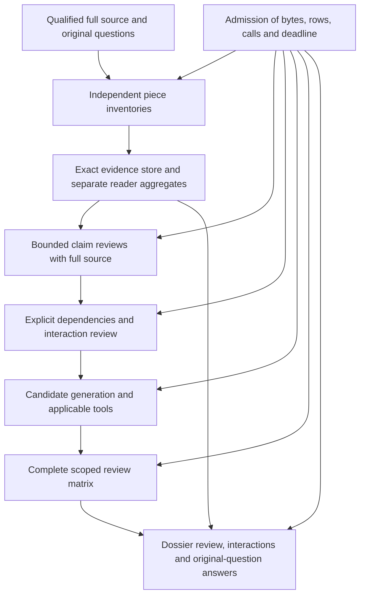

# Shared evidence design: preservation passes, full-route admission does not

10 October 2026. The [reviewed offline work package](../../../plans/legal-mission-evidence-route-design.md)
has executed. The prototype preserves the exact retained evidence and the source
qualification, but it does **not** qualify a further live product run. Compression
alone leaves full-inventory and search pressure inputs above the service cap.
The current scoped-review allocation also supports a smaller claim–candidate
matrix than the permitted generation can produce.

The source finding is retained in the [P10 evidence supplement](p10-effective-mitigation.md).
23EC52 distinguishes pre-activity understanding/assessment of controls from
effective mitigation in its complexity discussion. Its application to a Product
Provider needs the intermediary actor/activity bridge in 26EC22 paragraphs 9
and 18. This narrows the supervision evidence argument without selecting a
unique P10 discharge standard. The product has not yet generated an answer that
uses the distinction.

## Executed evidence and exact comparison

Command: `.venv/bin/python scripts/legal_mission_evidence_route_design.py`.
The retained result is
`artifacts/legal-mission-control/2026-10-10/evidence-route-design/diagnostic.json`.
Its manifest records the command, code/plan/input hashes, commit
`cde11a610cbd1e90eafecfa0cbda6efd51f9bef2`, Python executable/version, CPU-only
execution without any GPU import/detection, start time and 20.699-second runtime.
The calculation is deterministic; random seeds do not apply. No provider or
tool worker was dispatched. Live use remains 13/400.

The comparator is the exact packet of 55 units and four retained responses from
the terminal inventory-window run. Its partial aggregate has 78 claims, 22
authorities and 45 uncertainties over 53 units. The fourth response is still a
failed journal action; offline validation has not changed its status. The old
cross-check request is 747,591 bytes before source qualification, 778,370 after
qualification, 798,293 after output-reference preparation and 787,776 on the
existing readable wire. The prototype starts with the same prepared object and
reconstructs it exactly, including qualifications and all 105 quotations.

The codec keeps full source text literal, represents exact quotations by unit
and Unicode interval, shares repeated long strings, and replaces repeated object
keys with explicit column sets and rows. It is a diagnostic implementation in
`scripts/`, not a registered transport or production default. The trusted
expected request and packet hashes come from the retained caller record, not
from the encoded message itself.

| Measured input | Evidence class | Proposed wire bytes | 200,000-byte screen |
|---|---|---:|---|
| Original partial cross-check, with all 55 source units | Actual retained partial inventory | 185,956 | Pass |
| Partial atomic inventory plus a synthetic fifth piece: 158 claims, 62 authorities, 75 uncertainties | Synthetic pressure | 230,071 | Fail |
| Five synthetic independent-reader pieces: 400 claims, 200 authorities, 150 uncertainties | Synthetic pressure; not independent reading | 332,485 | Fail |
| Search constructor with both fixture inventories and their findings | Synthetic pressure; actual parent and tool feedback unavailable | 578,122 | Fail |
| Scoped constructor with 12 assigned pairs and an unformalized fixture reading | Synthetic constructor screen | 122,375 | Pass |
| Twenty source-check views, 20 claims each, full source and remaining unit/authority/uncertainty accounting in each | Synthetic view design | At most 177,210 | Byte pass only; whole-inventory review not established |

Response schemas are separate from these request-byte figures: 12,001 bytes for
cross-checks, 16,103 for generation and 14,020 for scoped review. Provider prompt
wrapping, token limits and model comprehension of this new encoding were not
tested. A request fitting 200,000 bytes is not by itself service qualification.

The fourth expanded response is 475,806 bytes. A reversible design envelope
including the complete source packet occupies 107,016 bytes; the already-retained
old span response was only 25,681 bytes. Thus the failure concerns where the
product expands and measures source evidence, not merely response verbosity.
The design envelope is not an accepted response under the current Inventory
schema and was never sent to a provider.

Ten negative controls refused changed sources, changed pooled text, unattached
table material, missing row fields, detached expected identity, excessive decoded
expansion, Boolean indices, out-of-range intervals, ambiguous quotes and empty
quotes. A Unicode/newline positive control reconstructed exactly. The first
execution stopped because the synthetic A/Q identifiers violated the existing
lowercase ID contract. One local diagnostic correction changed them to a/q; the
schema, retained source and production code were unchanged. The failed execution
is recorded in `diagnostic-correction.json` and is an implementation failure,
not evidence against the legal research direction.

## One architecture covering the complete route

The candidate design is a shared exact-evidence store with bounded review views
and an explicit interaction stage. It is selected for further design review,
not admitted to production. Its implementation has to satisfy the following
requirements together; completing only its codec would leave known failures.

**Store evidence once, preserving each occurrence.** Keep the packet, source
qualification, reader/piece identities, exact quotations, original row order,
authorities and uncertainties in an immutable store. Identical text can be shared;
different reader assertions and contextual occurrences cannot be merged merely
because they resemble each other. Preserve the current exact-commitment
coalescing rule and all provenance. Bind quotation intervals to the particular
source edition. Full-unit references remain legal data, even if inefficient;
do not shorten a quote and call that lossless preservation.

**Separate response contracts from internal aggregates.** Keep the one-response
Inventory limits at 80 claims, 40 authorities and 30 uncertainties. Five source
pieces imply upper count bounds of 400/200/150 per reader, before cross-review
material. The prototype preserves those rows in a distinct local aggregate.
Cross-review issues, their evidence and affected claim IDs belong in a separate
bounded collection; `apply_cross` currently appends only explanation/question text
to the already-full 30-uncertainty field. Original issue records must remain
available downstream, not just in a historical file. Source unit accounts and
all claim links require aggregate validation independently of byte fit.

**Place limits at their actual boundaries.** `JournalProvider.complete` checks
the unencoded request before calling CompactProvider and the expanded return
after it. It cannot adopt a new wire codec without a reviewed distinction between
logical input, encoded input, raw response and decoded response. The candidate
uses 16 MiB as a diagnostic logical/decoded limit, below `canonical.py`'s 20 MiB
hard ceiling; this is a bounded hypothesis, not a promoted default. The wire
input/output caps remain 200,000. Guard counts, depth and expansion before
materializing a potentially large result, then validate exact reconstruction,
source qualification and the relevant response contract. Check final size after
optional-tool augmentation and all encodings. Log prepared, wire and resolved
identities separately. A failure remains terminal for that reservation; no
historical failed action is silently accepted, refunded or replayed as success.

`source_context.ContextProvider` currently validates a literal/readable qualified
envelope. A generic encoded body needs an explicit verifier that reconstructs
against a trusted original record before this check. Sending the prototype
directly to the present provider would fail that contract. The source-reference
resolver and the scoped-response handler also need the same decoded-limit
semantics. Changing only the journal would move the failure downstream.

**Review all assigned claims against the full source, then review interactions.**
Each bounded view must carry the complete qualified 55-unit packet, exact assigned
claims and their dependency closure. Home assignments must account for every
claim; a unit/claim catalogue is navigation, not evidence that omitted contents
were read. Review output must preserve contrary sources, uncertainty and explicit
nonlocal dependencies. Route nominated interacting claims together and retain any
unresolved interaction. An additional interaction stage must address the combined
reviews and original questions before the aggregate is consumed.

This is a substantive change from the current single whole-inventory cross-check.
The prototype's 20-claim views establish byte fit and exact assignment only;
they deliberately record unavailable unassigned claim contents. They still carry
the old cross-check instructions for comparison, which ask for an unavailable
whole inventory and **must not be used live**. A revised task/schema and review
acceptance criteria are needed. Staged model summaries are fallible. Their data
coverage cannot prove equivalence to a reviewer seeing all raw claims together,
nor can a graph identify legal dependencies that were never proposed. The review
must test remote qualifiers, contrary evidence, missing dependencies and loss of
actor/timing/standard distinctions, including the new mitigation example.

**Make search consume the same evidence deliberately.**
`SourceCheckedSearch.retrieve` attaches all independent claims and findings to
later search diagnostics; compaction does not make the pressure fixture fit.
The actual retrieval also supplies uncited source units and the actual parent
reading, absent from the measured fixture, so its fit is not established.
Generation/refinement needs bounded reviewed evidence with original record
identities, accessible dependency closure and explicit unresolved reductions.
The baseline and tool-enabled arm must use the same source/claim delivery policy.
BM25 selections cannot replace the full source; tool receipts cannot replace
legal warrants. Unformalized P10 readings must survive alongside formalizable
trigger rules. If essential common material cannot fit, reject admission before
spending a model call rather than silently removing it.

**Budget the actual matrix and final answer, not an earlier example.** Scoped
review already partitions the complete pair set and keeps the whole source in
each request. Retain that property and the two independent perspectives, while
measuring the exact source/candidate/representation/tool/schema envelope and the
decoded judgments. Its internal 4,096-pair and 2 MiB-related fidelity limits are
additional finite constraints. The existing dossier consumer shares contents
while preserving occurrences, performs dependency closure and requires an
interaction review before synthesis. Reuse those contracts; admit the genuine
dossier, meaningful review outputs and final synthesis together. Its historical
492-pair packing proof is not a full-target qualification. A short, legally empty
synthetic reduction cannot stand in for the necessary reasoning.

## Whole-route call constraint

The current scoped allocation is 82 actions, batch size 12, with two mandatory
perspectives. Its exact minimum is `2 * ceil(pairs / 12)`, so it covers at most
492 distinct pairs before retries or followups. The pure existing `capacity`
function produced `scoped-capacity-arithmetic.json`:

| Claim count | Candidate scenario | Required pairs | Minimum scoped calls | Existing 82-call allocation |
|---:|---:|---:|---:|---|
| 78 actual partial claims | 6 hypothetical candidates | 468 | 78 | Fits with four spare calls |
| 78 actual partial claims | 7 hypothetical candidates | 546 | 92 | Fails |
| 78 actual partial claims | 12 hypothetical candidates | 936 | 156 | Fails |
| 558 synthetic pressure claims | 1 hypothetical candidate | 558 | 94 | Fails |
| 558 synthetic pressure claims | 12 hypothetical candidates | 6,696 | 1,116 | Fails calls and the 4,096-pair cap |

These are conditional arithmetic results, not counts of actual candidates. The
current source inventory is incomplete. The 78 claims already retained cannot
justify assuming the final matrix will stay below 492. The core fidelity stage
also conservatively reserves up to 200,000 bytes per pending batch against its
2 MiB aggregate budget: eleven pending batches fail that particular byte screen
even before later scoped review. Non-executable candidates may instead produce
deterministic diagnostic rows, so this is a conditional constraint, not a claim
that eleven model calls have been needed or made.

If the same 20-claim views were used for both readers, the pressure design would
need ten initial piece reads plus at least eight atomic and twenty qualification
claim-view calls, **38 before interaction,
generation or fidelity work**. That does not fit the 23 core calls remaining from
the original baseline's 36-call allocation. Seven detours and thirteen previous
calls remain charged. A future reviewed method must reconcile stage allocations
for equal arms inside the remaining global/arm budgets and absolute deadline.
The 400-call ceiling is not permission to spend an unaffordable stage plan.
Larger batches need output/latency/fidelity evidence; deleting candidate readings
or uncertainty to save calls would change the question.

## Implementation order and admission decision

There is one proposed implementation package, with an explicit return to the
P10/evidence answer comparison:

1. Specify and review the staged inventory/search protocol and resource
   envelope, including exact source access, aggregate bounds, output resolution,
   interaction treatment, pair universe and remaining calls. The measured
   overflows are the repair triggers. Decide precisely which guarantees change
   from the single-context method and how to evaluate the change.
2. In an isolated candidate, implement the shared evidence/aggregate types and
   logical/wire/decoded admission together. Integrate them at journal,
   source-context, source-reference and scoped boundaries; retain immutable
   historic runners and failed results. Add targeted malformed-reference,
   qualification, expansion and restart controls.
3. Exercise that candidate through the actual full-source constructors for both
   readers, cross-review, search, tool augmentation, core/scoped fidelity,
   dossier review, interactions and synthesis. Preserve an exact all-record
   reconstruction and run source-derived adversarial cases. Label synthetic
   outputs, measure schema/wrapper/token overhead, and refuse an unaffordable
   call/byte envelope before any live reservation.
4. Only after those engineering prerequisites pass, record a separately reviewed
   mission-method revision for a bounded equal-arm live comparison using the
   already selected Sol model. Begin with a complete baseline; compare the
   candidate's actual answer, source-supported inferences, contrary treatment
   and downstream tool consideration. Do not expand to all four questions or
   individual-tool comparisons until the initial answer pair exists.

Step 1 is the next unresolved design requirement. This document and the prototype
complete the admitted offline work; they do not admit step 2's production repair
or step 4's live run. The aggregate and interface repairs are feasible engineering
tasks. The preservation of cross-claim legal meaning under staged review remains
an evaluation question. Source research and conditional legal analysis remain
viable; their outcome is not invalidated by this transport/workload failure.

| Decision | Primary criterion | Veto status | Main uncertainty | Next justified action | Not concluded |
|---|---|---|---|---|---|
| Retain the exact-table prototype as a design component | Exact full-source/qualification reconstruction and ten negative controls pass | Complete inventory/search pressure exceeds 200,000 bytes | Actual model comprehension and unmeasured dynamic consumers | Review staged evidence and workload policy together | Production readiness or complete route repair |
| Do not dispatch an eighth live configuration | Whole-route capacity and call envelope are unqualified | Input overflow, incomplete actual generation, 492-pair allocation limit | Genuine claim/candidate counts and faithful reduction | Complete one bounded architecture revision before implementation/live admission | Failure of Sol, the tools or legal research |
| Retain the source refinement and original unresolved rivals | Exact passages support conditional role/timing/effectiveness distinctions | P10 discharge rule is still unresolved | Applicable actor/activity/edition/period and missing authority | Preserve that argument in the first actual complete answer review | Client compliance or closure of any of the 46 obligations |

| Inference status | Evidence |
|---|---|
| Hard veto screen | Three measured synthetic pressure inputs exceed the wire cap; conditional scoped workloads exceed 82 calls. Actual full target is not qualified. |
| Statistically supported ranking | None. No stochastic method, tool or model comparison was run. |
| Descriptive-only differences | Exact byte counts characterize these retained/fixture objects, not a latency or accuracy ranking. |
| Default readiness | No cap, batch size, source-selection, transport, model or legal standard was promoted. |
| Next evidence needed | A coherent staged-method contract and an affordable end-to-end candidate with source-derived failure cases, followed by real answer-level review if admitted. |

Post-run red team: the fixtures repeat seed content and may compress more readily
than real independent readings, yet still fail whole-input caps. The attractive
185,956-byte partial result omits an actual fifth response and actual second
reader. The 177,210-byte view result cannot establish that unseen claim contents
were reviewed together. Reductions may silently lose the mitigation applicability
bridge or replace P10 fulfillment with duty activation; those are substantive
rejection cases. The new generic encoding is not compatible with the existing
provider verifier without changes. The weakest evidence is model comprehension
and faithful interaction analysis, both untested. These limits prevent treating
successful reconstruction as a solution to English interpretation.

All four questions, 46 original obligations, 35 readings and zero of six
answer-level tool evaluations remain open. The selected tools have installed
checkpoint evidence from earlier work; this run adds no tool-benefit result.
Mission classification is `no_advance` for product evaluation, with the source
refinement recorded separately and **seven cumulative detours retained**.
