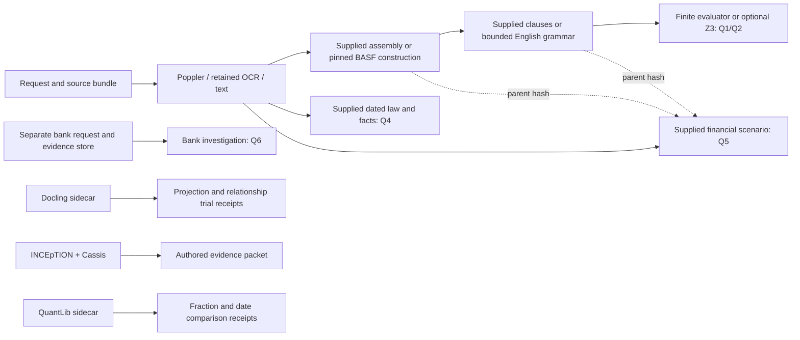

# Current prospectus package integration audit

8 October 2026. Audited commit: `03883b5f7d914a2678ac4f472e688c9fc1c60006`,
branch `feature/prospectus-evidence-master`.

**The package integrations are incomplete, and several remaining problems are
in our code.** Earlier repairs established useful, bounded capabilities: exact
source projection, real annotation authoring, Boolean solving, and numerical
comparison. They did not complete the connections from those capabilities to
source admission, selected-contract interpretation and independent evaluation.
This audit also reproduces defects at those connections. The remaining work
cannot be described solely as obtaining missing documents or human sign-offs.

The previous completion statement is accurate for its finite trial program. It
is too broad if read as completion of the prospectus service's package
integration. In particular, A3 consumes Docling's projection **inside the trial**;
the installed prospectus assessment does not consume it. The inspected code does
not establish that any entire candidate package is fundamentally unsuitable.

The [audit plan](../../plans/prospectus-package-integration-audit-2026-10-08.md)
records the pre-run skeptical review. The [evidence index](evidence-index.json)
binds 76 relevant source, test, configuration and evidence files. Coverage is the
tools and mechanisms named in the October 7 prospectus survey and October 8
integration repair, plus the actual assessment dependencies. This is not a review
of the unrelated assurance campaign or a guarantee that no other defects exist.
No service code, package installation or historical attempt was changed.

## What is actually connected

The installed command is `legalmath prospectus assess` or `consume`:
[CLI dispatch](../../../src/legalmath/cli.py#L105),
[service entrypoints](../../../src/legalmath/prospectus/successor/service.py#L202).

The omitted arrows from A3 and authored packets to the service are material
missing integrations. The QuantLib comparator is intentionally separate; it need
not run on every request. Financial P2/P3 hashes bind parent identity, while the
calculation currently takes its premises from the separately supplied scenario.

| Component | Actual producer, adapter and consumer | Current disposition |
|---|---|---|
| Poppler | `pdftotext -bbox-layout` → `source_graph.pdf_units` → P1 → assembly | Active PDF service dependency; host setup and failure handling incomplete |
| PyMuPDF / embedded Tesseract | Campaign-specific OCR worker → retained JSON → `retained_ocr_units` → P1 | Active retained-input adapter; general scan intake and corrected-text mapping incomplete |
| pypdf | Earlier acquisition/archive readers | Installed dependency, but not a fallback in the successor's P1 parser |
| Docling 2.60.1 | Two-page CPU sidecar → `project_layout` → A3/integration comparison files | Trial integration; no P1/P2/P3 consumer |
| INCEpTION 38 / Cassis 0.10.1 | Server exports → draft or strict XMI decoder → source-bound packet | Working exchange/authoring slice; no translation into service semantics or evaluation records |
| Playwright 1.58.0 | Browser operations and saved exports in isolated trial server | Tested driver, not a persistent reviewer service |
| Z3 4.16.0.0 distribution | `predicates.solve` → clause activation; separate bank engine also uses Z3 | Real runtime integration with scope-admission and explanation gaps |
| QuantLib 1.38 | Explicit development conventions → sidecar → fraction/date comparison | Working comparator slice; actual instrument integration incomplete |
| Hypothesis 6.151.9 / pytest | Generated read-context cache sequences plus named regression examples | Working test tools; coverage does not establish end-to-end package integration |
| ResearchAssistant | Literature discovery/parsing and OCR preflight helpers | Research tool use; not the service's automatic parser/router |
| ACTUS | Retained specification, wrapper, architecture and availability inspection | Numerical runtime and adapter not executed |
| FINOS CDM | Retained schema, bond example and Python-binding documentation | Exchange runtime and adapter not executed |

## Reproduced local defects and admission weaknesses

The [first probe](probe-results.json), [source-boundary probe](boundary-results.json)
and [codec probe](codec-results.json) preserve commands, commit, environments,
fixture provenance, method hashes and results. They use synthetic inputs only.
CPU devices were explicitly hidden. These are boundary diagnostics, not legal
accuracy experiments.

| ID / priority | Concrete trigger and observed behavior | Root cause and smallest closing check |
|---|---|---|
| G01 — High: retained OCR identity | A two-page JSON with page sequence `[1,1]`, `[2,1]` or `[0,3]` is accepted. Duplicate pages produce duplicate unit IDs. The `[1,2]` control succeeds. | [Loader](../../../src/legalmath/prospectus/successor/source_graph.py#L46) checks count against list length but not exact page sequence or unique unit identity. Require pages `1..N`, declared source coverage and unique units before graph creation; all three mutations must reject. |
| G02 — High: constraint applicability | Q1 is `UNKNOWN` with a missing trigger. Add a named constraint quoting an `EXCLUDED` alternative and Q1 becomes `YES`, with no unresolved items. | [Solver admission](../../../src/legalmath/prospectus/successor/predicates.py#L64) calls the raw [occurrence binder](../../../src/legalmath/prospectus/successor/anchors.py#L9), which checks availability and quotation, not selected-contract applicability. [Clause evaluation](../../../src/legalmath/prospectus/successor/clause_graph.py#L159) supplies the raw graph. Add a typed applicability admission tied to construction, question and purpose; test excluded, superseded, unrelated and governing-authority sources. External selection authorities can legitimately be premises, so a blanket ban on all non-body sources would be wrong. |
| G03 — High: AST reference targets | A fully copied two-unit AST produces operative IDs `ast:0` and `ast:2`. Resolving its reference with the available raw target fails; using `ast:2` also fails. | [Dependencies](../../../src/legalmath/prospectus/successor/service.py#L83) requires the same target ID in both raw and operative dictionaries. [AST assembly](../../../src/legalmath/prospectus/successor/construction_ast.py#L158) changes those IDs. Resolve through validated occurrence maps, with explicit handling of copied, split, replaced and excluded intervals. Test a real reference reaching an AST-selected definition. This result concerns the generic AST path; BASF currently preserves raw unit IDs. |
| G04 — High: evaluation source binding | A label with an unsupplied all-zero source hash, invented quotation and negative offsets `-10,-9` is counted as correct by `score`. | [Evaluation](../../../src/legalmath/prospectus/successor/evaluation.py#L19) checks dictionary shape, hash length and `end > start`; it neither loads the source nor binds the quote. Add source-graph occurrence validation and bind predictions to the actual method outputs. The probe does not establish a release bypass: release remains separately blocked and always requires human acceptance. |
| G05 — Medium: reader command format | The documented `admit` form fails on standalone XMI with `ValueError: Exported type system required`; the same CAS in ZIP with `TypeSystem.xml` succeeds. | [Codec](../../../scripts/prospectus_integration_codec.py#L15) does not accept a type-system argument although [the loader](../../../src/legalmath/prospectus/successor/annotation_xmi.py#L101) needs one for plain XMI. Either support explicit `--types` or document/validate ZIP as the required format. Both valid formats and missing-type failures need clear tests. |
| G06 — Medium: solver diagnostics discarded | Direct solving returns named contradictory constraints in `unsat_core`; the service returns generic conflict text and clause IDs without that core. Satisfying assignments are similarly lost. | [Clause evaluation](../../../src/legalmath/prospectus/successor/clause_graph.py#L185) reduces solver results to status and strings. Retain per-clause/premise solver reason, constraints, witnesses, bounds and unknown reason in P3 and the consumed report. Confirm explanations survive the installed CLI. |
| G07 — Medium: solver routing incomplete | Direct Z3 handles a thirteen-fact expression, while dated-law assessment with request `predicate_engine="z3"` and generic construction constraints raise the twelve-fact-domain error. | [Law](../../../src/legalmath/prospectus/successor/law_facts.py#L63) and [construction](../../../src/legalmath/prospectus/successor/construction_ast.py#L38) still call `decide`. The request option only reaches P3. Declare per-phase capabilities explicitly or route a common reviewed engine through these paths; domain exhaustion should have a structured disposition. This is a local supported-domain limit, not a solver limit. |

The excluded-constraint result does not show faulty Z3 entailment: Z3 correctly
solves the expression we admitted. Our admission admits a quotation without
establishing whether it may constrain that selected contract. Similarly, the
OCR probe checks JSON admission, not Tesseract recognition accuracy, and the
reference failure is between two local representations rather than a parser
defect.

## Missing service connections and unfinished capabilities

| ID / priority | Code/evidence finding | What is needed to close it |
|---|---|---|
| G08 — High: Docling service consumer | [P1](../../../src/legalmath/prospectus/successor/service.py#L28) calls [source graph construction](../../../src/legalmath/prospectus/successor/source_graph.py#L132), which selects retained OCR, text or Poppler. It has no layout admission. `project_layout` is called by [adoption trials](../../../src/legalmath/prospectus/successor/adoption_trials.py#L75) and [integration trials](../../../scripts/prospectus_integration_jobs.py#L13). | Add an optional versioned layout input bound to exact raw units, then make a named P2/P3 consumer use it. A selected-contract result must demonstrate the effect of a reviewed structure change; a mapping file alone is insufficient. Preserve the raw quotation authority. |
| G09 — High: governing relations and richer layout | [Projection](../../../src/legalmath/prospectus/successor/layout_adapter.py#L70) handles `texts` with one provenance region and orders pieces geometrically. [The worker](../../../scripts/prospectus_adoption_sidecar.py#L21) caps input at two pages and disables OCR and table structure. No legal scope edges are generated. Latest A3 has 53 mapped lines but **0/1 governing relations**, `baseline_failure_resolved=false`. | Admit reviewed governing edges through the same service path before trying automatic inference. Then test full page/table/multilingual/scan families under a new bounded plan. Original expansion was deliberately conditional on solving governing scope; its absence is not evidence that Docling failed every broader capability. |
| G10 — High: OCR corrections and new scans | [Campaign P1](../../../src/legalmath/prospectus/successor/jobs.py#L140) retains corrected transcription separately and explicitly leaves word-to-correction mapping unresolved. [OCR worker](../../../scripts/prospectus_closure_pdf_worker.py#L15) selects documents from an old BES inventory; [its runner](../../../scripts/run_prospectus_closure_next.py#L58) uses a fixed environment, English model and page list. The service does not invoke OCR for a new blank extraction. | Implement a bounded scan intake and language/profile selection boundary. Validate corrected text against images and a raw-to-corrected occurrence map; do not borrow old word boxes for changed text. Exercise a new scan through the installed service, including a genuinely blank page and a non-English case. This is primarily our orchestration/mapping gap. |
| G11 — High: authored annotations stop at a packet | [Draft decode](../../../src/legalmath/prospectus/successor/annotation_authoring.py#L44) produces groups, spans and relations, with independence unestablished. [Service request validation](../../../src/legalmath/prospectus/successor/contracts.py#L99) has no annotation input, and [P3](../../../src/legalmath/prospectus/successor/service.py#L115) takes supplied clauses/scope/observations. No caller translates authored exports into those structures. | Map CAS offsets back through extraction and assembly to source occurrences, then separately admit typed actors, effects, conditions, exceptions, questions and references. Handle cross-document evidence and edits. The existing [four-line BASF packet map](../../../scripts/prospectus_inception.py#L286) is useful development evidence, not a general translator. Test an authored exception that changes the actual service answer. |
| G12 — High: reviewed BASF meaning cannot become operative through the current profile | [BASF construction](../../../src/legalmath/prospectus/successor/basf.py#L248) always reports PARTIAL/full-contract false. [Its assembly adapter](../../../src/legalmath/prospectus/successor/basf.py#L254) leaves retained body text UNKNOWN; it has no reviewed-role admission. P3 [rejects promotion of UNKNOWN source to an operative clause](../../../src/legalmath/prospectus/successor/clause_graph.py#L109). The automatic [grammar](../../../src/legalmath/prospectus/successor/clause_graph.py#L28) recognizes only a few exact English forms. | Preserve those safeguards and implement a source-reviewed disposition/meaning admission, including margins and definitions. German and general English interpretation remain unimplemented beyond supplied clauses. More field substitutions cannot alone complete this path. Independently test reviewed-input and automatically assembled-input arms using the same evaluator. |
| G13 — Medium: reference semantics remain bounded | [Reference discovery](../../../src/legalmath/prospectus/successor/source_graph.py#L7) recognizes numeric Condition/Section/Clause/Article/§ mentions, not all named, relative, table or external references. [Clause references](../../../src/legalmath/prospectus/successor/clause_graph.py#L121) deliberately leave priority and negation unresolved and set authority to `None`; nested activation is retained as unresolved. | Define occurrence-bound reference and priority admissions, including governing authority, language and edition. Demonstrate distant exceptions and amendments through the actual constructed text. Unsupported cycles should remain explicit. LegalRuleML or argumentation literature supplies representational ideas, not an already integrated reasoner. |
| G14 — High for instrument delivery: numerical scenarios are not derived from the selected contract | [Financial P5](../../../src/legalmath/prospectus/successor/service.py#L148) verifies P2/P3 hashes then calls `financial_profiles.assess` with a scenario and raw graph. It does not use selected clause meanings to derive or validate rate/day-count/entitlement. [Fixed coupon](../../../src/legalmath/prospectus/successor/fixed_coupon.py#L102) supports explicitly hypothetical premises only. Source anchors plus reasons are interpretations, not a checked term-to-value translation. | Add a reviewed contract-terms admission tied to selected occurrences and interpretation, then compare the exact local calculation and QuantLib on the same admitted instrument terms. Verify changing an operative rate/convention invalidates the old terms. Maintain the existing conditional label until that evidence exists. |
| G15 — Medium: financial comparison coverage | [QuantLib worker](../../../scripts/prospectus_adoption_sidecar.py#L45) compares explicit reference schedules/year fractions and three calendar dates under two adjustments. [Local finance](../../../src/legalmath/prospectus/successor/financial_profiles.py#L110) offers coupon and named loss/conversion subcalculations, not full settlement. No A4 actual coupon admission is present. | Extend only to required schedule generation, stubs, calendars, entitlement, event ordering and rounded transfers with independently derived expected results. FX, tax, floating/reset/call features and actual settlement remain outside the current slice. Requiring QuantLib as a per-request dependency would not itself solve any missing contractual premise. |

The current source obligations remain real: 15 bracket fields and 537 unresolved
intervals, including 496 margins and 26 headers; agent details, references and
incorporated documents still need review. But G08–G15 describe software work that
remains even after the missing source decisions become available.

## Reproducibility, testing and acceptance connections

| ID / priority | Finding and evidence | Closing action and limit |
|---|---|---|
| G16 — Medium: extraction setup and replay freshness | [Poppler extraction](../../../src/legalmath/prospectus/successor/source_graph.py#L10) invokes the host binary directly. `pyproject.toml` does not install it. Missing-binary simulation raises raw `FileNotFoundError`; the [CLI](../../../src/legalmath/cli.py) only formats `LegalMathError`. Standalone [consume](../../../src/legalmath/prospectus/successor/service.py#L164) rechecks document bytes but not OCR/acquisition/admission files or extractor identity. Changing only OCR leaves stored-product replay identical, while fresh intake rejects the old hash. | Add dependency preflight, a typed extraction failure, and explicit frozen-replay versus current-assessment modes. Frozen replay can legitimately use embedded P1 bytes; do not mislabel it as a fresh evaluation. Pin/record extractor versions and revalidate the full derivative chain when currentness is promised. Poppler is present on this host; this is a portability/error-handling finding. |
| G17 — Medium: environment restoration | [Sidecar setup](../../../scripts/prospectus_adoption_tools.py#L12) uses `/tmp`, top-level package pins and a resolver report, not a locked transitive reinstall. Model setup refuses an existing receipt even if temporary model files have disappeared. [Browser driver](../../../scripts/prospectus_integration_authoring.py#L124) uses an absolute user path. Cassis, Java, browser and OCR environments are separate. [A5 installation](../../../src/legalmath/prospectus/successor/adoption_jobs.py#L220) uses `--no-deps` and the current application interpreter. | Provide explicit optional capability profiles, durable configurable paths, fully pinned restoration and an offline/missing-resource preflight. Test a new location with an empty sidecar/model directory. An unchanged missing runtime should be reported with a restore action. This is local packaging, not proof that these packages require incompatible environments. |
| G18 — Medium: runtime reads and controller coverage | [ReadContext](../../../src/legalmath/prospectus/successor/read_context.py#L92) hashes the executable and declared inputs, but does not confine or enumerate child reads. A child reads an undeclared file; changing it leaves `current=true` in the probe. [Bindings](../../../src/legalmath/prospectus/successor/adoption_jobs.py#L16) hash broad sets for every phase. [Hypothesis state machine](../../../tests/prospectus_successor/test_adoption.py#L171) tests a one-file cache model, not the complete prospectus controller. | Retain the explicit no-confinement limitation; use declared/observed subprocess inputs or isolated execution where needed. Add generated sequences through real phase boundaries and narrow invalidation only after dependencies are known. Existing named controller tests remain useful. This confirms a documented boundary, not a broken promise that ReadContext is an OS sandbox. |
| G19 — High before acceptance: incomplete review-to-score evidence | [A6](../../../src/legalmath/prospectus/successor/adoption_jobs.py#L289) accepts caller-provided labels/predictions/identities; [score](../../../src/legalmath/prospectus/successor/evaluation.py#L7) has no individual first-reading records, assignment authentication, disagreement/adjudication record verification, or execution binding for the supplied predictions. Exposure rejection in A6 compares IDs; family exclusions remain caller-supplied. | Join preserved exports and authenticated assignments to exact source-bound labels, adjudication and frozen method predictions. Enforce issuer/template/amendment-family exclusion mechanically. Real qualified readers are an external requirement, but this evidence path is our implementation work. The latest A6 has no review or actual-fact admission and correctly remains blocked. |
| G20 — Medium: trial success, artifact currentness and task completion differ | [A3](../../../src/legalmath/prospectus/successor/adoption_jobs.py#L195) wraps its result in `artifact_ready=true` even while its primary governing-relation criterion is unmet. [Controller currentness](../../../src/legalmath/prospectus/successor/controller.py#L158) establishes valid reusable artifacts; [refresh](../../../src/legalmath/prospectus/successor/controller.py#L207) lists open implementation obligations with no handler. The [verifier](../../../scripts/verify_prospectus_adoption.py#L43) checks replay/currentness and test success. | Expose distinct fields for execution, artifact validity, primary criterion, consumer integration and acceptance. A failed candidate can remain a valid reusable result and allow a planned repair phase; do not turn a promotion veto into a blanket stop. Tie the next engineering action to a concrete missing consumer/repair instead of equating all-current phases with completed integration. |

The 153-test receipt is valid evidence for its stated regression scope. It does
not cover the reproduced failures above. The installed checks run packaged
`consume` on products mostly constructed in the checkout; there is also a genuine
installed BASF constructor equality check. This is stronger than an import smoke
test but narrower than running new PDFs, OCR, layout, annotations and derived
terms through a clean installed service. The [fresh-install script](../../../scripts/fresh_install.sh)
checks installation/resources/version, not that full prospectus path.

The previous live trial is also real: eight persisted authoring exports and four
cross-account denials. It used synthetic accounts and text in a bounded localhost
server that was stopped afterward. Durable deployment, actual identity/assignment
management and real adjudication remain untested. General schema libraries such
as Pydantic/jsonschema are core dependencies elsewhere; the successor's admission
uses custom dictionary checks. Installing those libraries is not equivalent to
applying a complete schema at these boundaries, and migrating to them is optional.

## Deferred packages and surveyed alternatives

| Candidate | Current reason for absence | Attribution and next discriminating evidence |
|---|---|---|
| ACTUS | No local pinned numerical core/runtime or term adapter. Retained service build names core 1.1.0; an older README names 1.0.1. An unauthenticated core request returned 404. Official Python architecture delegates event simulation to a backend. | Access/version/licence and local implementation prerequisites. Obtain the exact usable core and inspect its terms/code, then compare a plain principal-at-maturity schedule, payoffs and states with independent enumeration. No numerical package defect has been demonstrated. |
| FINOS CDM | No receiving-system version/profile, required-function list or executable adapter. The inspected Python documentation explicitly describes native Java stubs needing registered Python replacements. The inspected source build needs Java21. | Missing local requirements plus a documented binding limitation. Choose the required exchange path and test an official bond fixture with condition validation, reference resolution and semantic round trip. Java or reviewed Python replacements may be suitable; wholesale rejection is unsupported. |
| RuleIR / Catala / Lean | Reused formal infrastructure exists; the bank adapter constructs RuleIR models and uses Z3. The successor's dynamic clause graph is not lowered into a new Catala/Lean proof by this campaign. Existing Lean results concern specified arithmetic/Boolean statements. | No general proof of prospectus translation. Reuse formal backends after a typed source-to-meaning translation exists; do not count prior mathematical results as proof of the new adapters. The unrelated assurance campaign is outside this audit. |
| Web Annotation / Akoma Ntoso / PROV-DM | Survey recommends identity, exact occurrence and derivation concepts. Current formats remain local JSON; no standards-compliant XML/RDF exchange was proposed as a prerequisite. | Partial conceptual adoption is appropriate. Validate the local representation and fix G01–G04/G11 before claiming interoperability. Full standards serialization requires a concrete receiver. |
| ContractNLI / SARA / DocLayNet / OmniDocBench | Used as evaluation/annotation methodology, not integrated model packages or legal gold labels. Reviewed-versus-automatic end-to-end arms and independent family-separated acceptance are still missing. | Local evaluation program remains incomplete. OmniDocBench aggregate metrics and ignore categories cannot replace governing-margin/exception checks. |
| CUTECat; LegalRuleML/ASPIC; Stipula/eFLINT/Symboleo/ContractCheck | Borrowed testing or semantic ideas; no migration/runtime adoption justified by this prospectus program. | Deferred applicability work, not failed local runtimes. A named missing semantic/execution requirement should precede a trial. |
| brat; MinerU; olmOCR; Marker; PaddleOCR; OCRmyPDF; GROBID | INCEpTION was selected for the annotation trial. Alternative parsers were screened or named, with differing depths of inspection; no comparative local trial establishes superiority or inferiority. | Not rejected packages. Test an alternative only against a specified remaining extraction failure, with exact source conservation and the same reviewed target. |

The ACTUS/CDM findings rely on preserved official-source inspection; this audit
made no new availability request and cannot establish today's external access.
The relevant [retained decisions](../prospectus-integration-repair/feasibility-006/deferred-tool-decisions.json)
remain narrower than a runtime verdict.

## What explains the repeated partial closure

There are several representations with different admission rules: raw PDF/OCR
units, layout regions, CAS offsets, selected-contract units, clauses, Boolean
premises, financial scenarios and evaluation labels. Individual packages work on
one or two of these. Their adapters do not yet preserve source identity,
applicability and meaning through the entire sequence. Tests concentrate on those
individual representations and fixed examples, so they can pass while a later
connection is absent or weaker.

The decisive target is a source-to-answer path under declared legal premises.
The trials currently compute narrower things: retained-character maps, transport
round trips, Boolean consequences of caller-supplied expressions, and fractions
under supplied conventions. Those quantities are useful but different from the
target. The call graph and counterexamples above establish that distinction.
Nothing here proves automatic interpretation, a complete selected instrument,
authentic reader independence, or population accuracy.

| Decision | Primary criterion | Veto status | Main uncertainty | Next justified action | Not concluded |
|---|---|---|---|---|---|
| Repair local admission first | Reproductions establish G01–G07 | Source identity/applicability and evidence binding are inadequate for stronger claims | Actual production inputs exercising each failure | Add focused adversarial regressions and repair the shared boundaries | Whole package failure |
| Complete consumers | G08–G15 are incomplete by call-site/consumer inspection | No end-to-end claim justified | Correct source-reviewed meaning remains external | Implement one bounded real-instrument path with explicit intermediate admissions | Parser/model generality |
| Harden restoration and evidence | G16–G20 remain partial | No clean-host or independent-acceptance claim | Untested deployment and hidden native dependencies | Explicit runtime profiles, real-controller tests and bound reviewer/prediction records | Full confinement or human authenticity from hashes |
| Keep ACTUS/CDM deferred pending prerequisites | No numerical/exchange runtime trial | Package acceptance untested | Core availability / required receiver functions | Run the recorded smallest trial when prerequisites exist | Fundamental unsuitability |

The next repair order should be: source/constraint/reference/evaluation admission;
layout and annotation consumers; reviewed selected-term-to-finance connection;
portable runtime restoration and end-to-end controller checks; then independent
family-separated acceptance. Authentic readers and missing legal/event sources
can be arranged alongside the software work. This audit proposes the order but
does not execute those repairs.

Post-audit red-team: optional comparators were never promised as runtime defaults,
so their absence from per-request execution is not itself a defect. The reported
gaps concern missing promised consumers or validations, with the comparator role
kept explicit. Synthetic boundary failures establish local behavior, not their
frequency in retained prospectuses. Frozen replay may intentionally outlive a
changed derivative; currentness must be stated separately. A validated downstream
consumer, source applicability admission or authenticated evaluation chain not
found in this inspected path would require revising the corresponding finding.
No stochastic ranking or new default recommendation follows from this audit.
