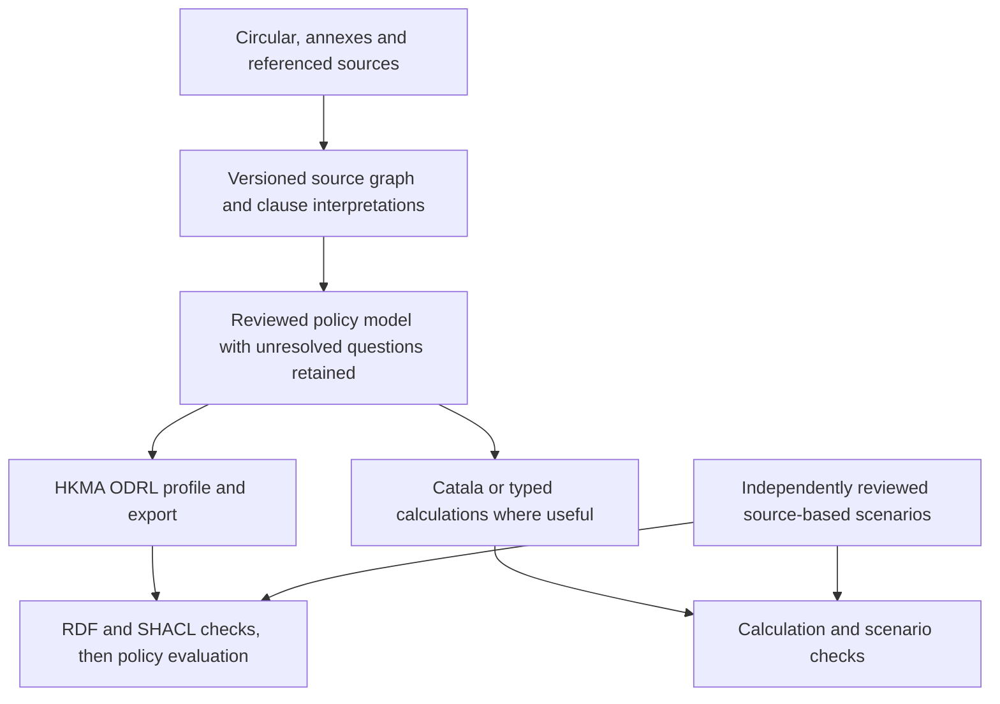

# Translating the SFC–HKMA suitability circular into ODRL

Literature and software survey · 22 October 2026

The first pilot should produce **ODRL from a reviewed, source-linked interpretation of the circular, without requiring a Catala program first**. Catala should supply selected calculations and an additional executable check. Both representations should remain connected to the same source passages, while independently written scenarios check whether the interpretation is faithful to the circular.

There is already research on natural-language-to-ODRL translation, regulatory ODRL profiles, and formal policy evaluation. There is also reusable software. What the inspected evidence does **not** establish is an automatic, legally faithful translator for an HKMA circular, or a single evaluator whose default semantics cover this case. The practical opportunity is to combine existing components around a deliberately small HKMA profile and a source-based evaluation set.

This survey uses the **28 July 2023 joint SFC–HKMA circular, reference 23EC35**, *Streamlined approach for compliance with suitability obligations when dealing with sophisticated professional investors*, together with its seven-page Annex 1 and three-page Annex 2 [S1]. The two annexes downloaded from the SFC match the repository copies byte for byte. The circular body was also retrieved from the official SFC service and inspected. This is a historical translation case: the survey does not establish the complete set of obligations currently in force, and the circular's references to the Code of Conduct, Professional Investor Rules and earlier FAQs remain dependencies to resolve before operational use.

The supporting [reading notes](reading-notes.md), [software audit](software-audit.md), [source manifest](sources.json), and [review record](review.md) distinguish technical reading, source-code inspection, documentation-only findings and unavailable originals. No model generation, third-party software test suite, or HKMA translation benchmark was run.

## What the circular requires the translation to preserve

The circular is especially useful because it is about a **conditional relaxation of particular point-of-sale procedures**. Its central question is whether an intermediary may apply the Streamlined Approach to a particular client and transaction. A permission to apply that approach is different from a permission to execute the investment transaction under every applicable rule. Failing the streamlined criteria may leave an ordinary suitability route available.

Qualification is also more than a wealth test. Annex 1 combines professional-investor status, a financial threshold, knowledge or experience, and investment objectives. The approach then depends on specified product categories, a client-selected streamlining threshold, prior agreement and continuing review. Some steps are calculations; others require evidence or professional judgment. The translation must preserve the circular's wording, including “should,” “required,” and “reasonably satisfied,” rather than converting every sentence into an unconditional prohibition or obligation.

| Source | Meaning to preserve | Representation and decisive test |
|---|---|---|
| Annex 1 §§1–3.1 | SPI qualification includes an Individual PI and the other eligibility criteria. The financial alternative is portfolio **at least HK$40m OR net assets excluding the primary residence at least HK$80m**, including equivalent currencies. | Typed, source-linked eligibility predicates. Equality satisfies the relevant financial limb; financial qualification alone does not establish SPI status. |
| Annex 1 §§2, 3.2–3.4 | Qualifying investment-holding corporations, joint holdings, associates, written allocations, default allocations, liabilities and the primary residence affect the assessment. | Preserve separate legal definitions and calculations. A joint account cannot automatically be counted wholly for every holder. |
| Annex 1 §4.1; §7.3; Annex 2 FAQ 2 | The knowledge/experience limb may be met through a relevant degree or postgraduate diploma, a professional qualification in finance, at least one year of relevant professional work in the financial sector, or at least five transactions in the same product category within the past three years. The category restriction matters when relying on trading experience. | Compute category-specific histories with an explicit reference date. A representative's expertise is not automatically the client's expertise; transactions through a representative or joint account may nevertheless count. |
| Annex 1 §5.1 | Conservative clients are excluded. | An unknown investment objective is not proof that the client is nonconservative. Preserve an unresolved outcome. |
| Annex 1 §§6–7; Annex 2 FAQs 3–4 | The client specifies product categories; category information and explanations on request remain relevant. Products with loss-absorption features require distinct treatment in categorisation. | Link category membership to evidence about product terms and risks. This is a direct use for the prospectus work. |
| Annex 1 §§8.1–8.2; Annex 2 FAQ 5 | The client specifies an absolute threshold or a percentage of AUM, with recorded rationale. | Distinguish this threshold from the HK$40m/HK$80m qualification thresholds. Represent the threshold's amount, basis, currency, effective time and rationale. |
| Annex 1 §8.3; Annex 2 FAQs 6–7 | Transaction-based monitoring and designated-account monitoring have different triggers. Gross exposure includes leverage; transferred-out noncash exposure still counts. | Use distinct event-conditioned rules and exposure calculations. Account balance alone is not the prescribed measure. |
| Annex 2 FAQ 6, final paragraph | An above-threshold designated account may continue to operate and execute transactions while top-ups/deposits are restricted; there is no expectation to reduce or unwind exposure for this purpose. Ordinary procedures are another route. | **Reject the translation “above threshold ⇒ prohibit every trade.”** Test existing-account transactions separately from new funds and ordinary-route transactions. |
| Annex 1 §§8.4–8.5 | Systems should detect outsize/material transactions, warn as specified, and review threshold compliance. | Continuing controls and evidence of performance belong alongside transaction permissions. Merely activating a duty does not fulfil it. |
| Annex 1 §§10–11 | Specified procedures are “not required,” with differences between solicited/recommended and unsolicited complex-product transactions. Other documents and safeguards remain. | Preserve a **dispensation from a specified requirement**. Do not represent it as a prohibition on explanation or as a blanket suitability exemption. |
| Annex 1 §§10.3, 11.4 | The product-explanation relaxation has exceptions for requests and material queries. | Test both absence and presence of a request, and distinguish required performance from permission to proceed. |
| Annex 1 §13.1 | Written agreement/consent, written criteria/categories/threshold and an explanation of consequences and withdrawal rights precede use of the approach. | Use dated evidence of prerequisites. A promise to obtain consent later must not satisfy prior consent. |
| Annex 1 §§13.1(d), 13.2(c)–(d), 14 | Clients can withdraw, change categories and amend thresholds; annual review checks continued qualification and agreement and provides written reminders. | Model state changes and recurring review. Do not silently replace “annually” with “every 365 days” or let an old consent event authorise indefinitely after withdrawal. |
| Annex 1 §12; Annex 2 FAQ 1 | Assessment and communications records are required as specified; documentary evidence is not universally mandatory where reasonable KYC efforts and disclosed information suffice. Inconsistencies require clarification. | Separate the obligation to keep records from an invented universal documentary-evidence prerequisite. |

The table is an inventory for designing a pilot, not a complete formalisation. In particular, “reasonably satisfied,” “appropriate,” and “material” need a recorded assessment, supporting evidence and an interpretation. Inventing a numerical cutoff to make these terms executable would change the source.

## What the literature has actually demonstrated

### Direct translation into ODRL

**Revel, Lamercerie, Foret and Miklos, “Extracting ODRL Digital Right Representations from License Texts using AMR” (ASAIL 2023)** [L1] is a useful explicit-intermediate-representation baseline. It parses a sentence into Abstract Meaning Representation, converts that representation into RDF, and uses semantic transduction to derive ODRL. Its attraction is that the translation has inspectable stages rather than only a final generated policy.

The experiment is much narrower than a circular. It uses approximately 100 simple deontic sentences, about 20% handcrafted and the remainder generated from a grammar, plus ten additional negative examples (clarified against §5.1 during LaTeX integration). Reported modality extraction has precision 0.780, recall 0.640 and F-score 0.703; action extraction has precision 0.989, recall 0.810 and F-score 0.891. These measure extraction of components, not correctness of whole policies. The authors explicitly leave document preprocessing and resolution of definitions as hypothetical parts of the workflow. Their discussion of negation scope—“may not reproduce” becoming permission not to reproduce—is directly relevant to the HKMA distinction between prohibition and dispensation. AMR's treatment of quantification and time is another reason to retain a legal interpretation layer. The original tools are linked in the paper, but their implementation was not audited in this survey.

**Mustafa et al., “From Instructions to ODRL Usage Policies: An Ontology Guided Approach” (LLM+KG at VLDB 2024; retained arXiv version posted in 2025)** [L2] is the closest simple LLM baseline. It supplies the ODRL ontology, curated human-readable explanations and examples, then asks the model to refine its output. It evaluates 12 cultural-dataspace use cases with three models and three methods: 108 configurations. The paper says each use case was initially run once. The widely quotable **91.95% is 217 out of 236 selected checks for Use Case 1 with refinement**, not a measured 91.95% probability of legally correct translation.

The associated repository, LLM4ODRL, contains generation scripts, examples and pySHACL validation. Its shapes also require application metadata such as creator, title, description and issue date. Such requirements can be useful project rules, but they are not all universal W3C ODRL conformance requirements. For our pilot, this work supports ontology-guided drafting and structural correction. It supplies no evidence that the resulting rules preserve an HKMA circular's cross-references, changing client choices or exemptions. No repository-level licence was found in the inspected checkout, so public availability should not be treated as an open-source reuse grant.

**Zhong, Huang and Du, “AgentODRL: A Large Language Model-based Multi-agent System for ODRL Generation” (AAAI 2026)** [L3] is the most directly relevant larger translation study inspected. It adds orchestration, reference rewriting, decomposition, ontology-guided generation and SHACL-guided correction. Seventy seed cases were expanded with Gemini into 770 cases: 440 simple, 220 with parallel relationships and 110 with sequential dependencies. It also uses synthetic training examples for a checkpoint-extraction model.

Its two principal scores need careful interpretation. The grammar score is based on selected SHACL violations. The semantic score uses checkpoints extracted by a model and assessed by two LLM jurors. The study reports repeated-run averages, but these are not an independently adjudicated legal outcome benchmark. Very high reported scores therefore support further investigation of the method, not automatic acceptance of the translation. The workflow comparison also does not justify assuming the adaptive orchestrator is always the best choice: fixed preprocessing workflows have higher aggregate semantic scores in the reported comparison. A small pilot should compare a simple ontology-guided baseline with explicit reference handling before adopting the whole orchestration system.

AgentODRL's Apache-2.0 source is useful for studying prompts and decomposition. The inspected code has bounded reflection, but a final candidate can be retained after the correction budget is exhausted. The production wrapper must record whether validation actually passed and preserve failed candidates as failed. Rewriting references also needs a source map: flattening a paragraph must not discard the exception that qualified it. This is where the existing prospectus work is more valuable than simply copying the paper's rewriting prompt.

Earlier work exists. **Cabrio, Aprosio and Villata, “These Are Your Rights: A Natural Language Processing Approach to Automated RDF Licenses Generation” (ESWC 2014)** [L4] used NLP/classification for licence representation. The AMR paper describes its 37-licence experiment. The original was not recovered here, so it is a historical lead, not independently inspected performance evidence. Taken together, these studies establish that text-to-ODRL is an existing research problem. Their inspected evaluations remain substantially different from translating this complete circular and its annexes.

### Regulatory profiles and the meaning of a policy

**De Vos, Kirrane, Padget and Satoh, “ODRL Policy Modelling and Compliance Checking” (RuleML+RR 2019)** [L5] is an especially relevant prior-work lead. The publication record and later technical literature describe an ODRL regulatory profile and translation into answer-set programs for compliance checking, including GDPR examples. This places regulatory ODRL work well before current LLM translators. The original attachment remained inaccessible after bounded retrieval attempts; this survey therefore does not claim to have verified its detailed encoding or evaluation, or recommend copying its proposed extensions without reading it.

**Kebede, Sileno and van Engers, “A Critical Reflection on ODRL” (2021)** [L6] examines the difference between representing usage permissions and modelling legal relationships. Its technical discussion of duty, obligation, institutional power, delegation/revocation and policy lifecycle explains why a regulatory circular can exceed the semantics of a basic access-control policy. For this case, client withdrawal and amendment are changes to normative state; an exemption removes or qualifies a particular requirement; and an intermediary, client and regulator have different roles. The critique is a source of modelling questions, not a claim that subsequent ODRL work has made no progress.

An inspected example of a domain profile is **AIUP**, by Golpayegani, Esteves, Pandit and Lewis, associated with their SEMANTiCS 2024 paper [L7]. Its published profile defines intended/precluded AI uses, human-oversight conditions and reporting requirements using ODRL and related vocabularies. Its explicitly limited scope is instructive: it does not claim to encode the whole EU AI Act. The profile specification was read; the associated research paper was not technically evaluated. The lesson for HKMA is to define exact domain terms and supported questions, rather than rename every action `odrl:use` and assume the meaning is portable.

The normative **W3C ODRL 2.2 Information Model** [S2] supports permissions, prohibitions, duties attached to permissions and duties attached to a policy through `odrl:obligation`. These relationships are not interchangeable. Sections 2.6.1 and 2.6.5 make the attached duty a prerequisite of permission. Section 3 requires a profile for additional semantics and requires a processor to stop if it does not recognise a declared profile. Adding custom vocabulary is therefore supported, but a profile IRI alone cannot make a generic evaluator understand a dispensation, annual review or client withdrawal. The W3C community's evolving semantics document [S3] is useful supplementary work; it is not itself the 2018 W3C Recommendation.

### Formal semantics, comparison and execution

**Bonatti, Fornara and Harth, “Towards a Formal Semantics of the Open Digital Rights Language (ODRL 2.2)” (OPAL 2025)** [L8] gives model-theoretic definitions of rule activation, action matching, duties and compliance over traces. The valuable result for this project is its explicit identification of choices that an implementation otherwise makes silently. Does one duty performance authorise one later action or many? Does a duty's constraint specify when it is activated or a condition of its fulfilment? Which policy governs a duty-performing action? What happens when neither a permission nor a prohibition applies?

The paper makes provisional choices and marks unresolved questions, including temporal operands and `andSequence`. It does not certify every interpretation used by today's evaluators. For the circular, the once-versus-repeated-performance distinction separates consent to a continuing arrangement from an explanation required for a particular request. A single old “explanation provided” event must not discharge every future explanation duty.

**Salas, Pareti and Konstantinidis, “ODRL Policy Comparison Through Normalisation” (2026)** [L9] develops a way to normalise and compare rules under a declared semantics. It decomposes numerical/symbolic conditions into matching regions and proves preservation results for the supported fragment. This suggests useful future checks: detect overlapping eligibility regions, compare revised threshold conditions, or establish equivalence of two supported exports.

Its scope matters. The analysis omits attached duties, remedies and consequences. Its policy-preservation theorem keeps standalone obligations unchanged: splitting one obligation into several independently required obligations would change its meaning. It also reports exponential growth in the number of attributes and leaves empirical performance evaluation to future work. This is a research basis for bounded comparison, not a ready-made proof that arbitrary ODRL policies—or an ODRL policy and a Catala program—are equivalent.

**Salas, Pareti, Aslam, Maidens and Konstantinidis, “A Formally Grounded ODRL Evaluator: Implementation and Comparison” (2026)** [L10] defines offline monitoring, streaming monitoring and access decisions and presents **OVAL**. The algorithm records rule matches and outstanding requirements while processing events. This is substantially closer to the circular's combination of transaction decisions and evidence of performance than a JSON validator.

The paper's evaluation uses synthetic policies/events and comparison with the SolidLab/FORCE test suite. It reports agreement on **54 of 68 cases**, after treating the other evaluator's “not enough information” as false; disagreements include different reasoning and duty interpretations. That is a reason to resolve semantics before comparing runtimes. The reported speed differences are author measurements on those workloads, not evidence that one tool is universally more correct or suitable for HKMA. Current October 2026 code also contains capabilities and settings beyond the July paper, so the paper's feature matrix must not substitute for inspecting the version actually used.

**Cimmino, Cano-Benito and García-Castro, “Open Digital Rights Enforcement Framework (ODRE): from descriptive to enforceable policies” (2024 preprint)** [L11] tackles another necessary problem: connecting policy terms to executable operands and actions. Python/Jinja and Java-based implementations interpolate runtime values and evaluate policy expressions. The paper demonstrates 24 test cases per implementation and explicitly limits its tested enforcement to synchronous scenarios; temporal monitoring is future work in that version. This is useful architecture for external facts, but the inspected Python code raises concrete rule-type and constraint-traversal concerns. It should not be selected as the circular's general compliance evaluator without resolving them.

Related work by **Slabbinck et al., “Interoperable Interpretation and Evaluation of ODRL Policies” (ESWC 2025)** [L12], and **“May the FORCE be with you? A framework for ODRL rule compliance through evaluation” (2025)** [L13] belongs in the reading list. Full technical papers were not obtained in this survey. The associated FORCE evaluator and test-suite code were inspected directly; the software findings below do not depend on claiming to have read those papers.

### What adjacent legal languages contribute

**LegalRuleML** [S4] explicitly addresses constitutive and prescriptive rules, defeasibility, alternative interpretations, source correspondence, authority and time. Its specification gives a much closer vocabulary for the legal interpretation record than a bare list of access permissions. It is a representation standard, however, not an automatic translator or one universally defined executable engine. We can reuse these distinctions in the repository's internal model without making XML conversion a prerequisite to the ODRL pilot.

**eFLINT**, introduced by van Binsbergen et al. (2020) [L14], represents actors' powers and duties through facts, actions and events that create or terminate normative relationships. Its distinction between action compliance and duty compliance is particularly useful here: a transaction may be allowed while a review or recordkeeping duty remains outstanding. Client withdrawal also has a natural interpretation as a state-changing act. The language is an adjacent option if the pilot reveals that such lifecycle reasoning dominates. This survey does not select or benchmark an eFLINT implementation.

**Catala**, introduced by Merigoux, Chataing and Protzenko (2021) [L15], targets legal computations with general cases and exceptions. It is well suited to the financial and counting portions once their interpretation is specified. Its paper proves properties of a core compilation step; that proof does not establish that a human or model correctly interpreted the circular, nor that a separately generated ODRL policy has the same meaning. The distinction is decisive when considering Catala as a validator.

## Which software to use, and for what

This is a shortlist based on bounded static inspection, not a benchmark ranking. Full commit identifiers and inspected paths appear in [software-audit.md](software-audit.md) and [sources.json](sources.json). A repository's recent push date is not evidence that its inspected default branch changed on that date.

| Component | Licence observed | Role in the pilot | Limitation that affects the choice |
|---|---|---|---|
| [AgentODRL](https://github.com/RUC-MAS/AgentODRL), including the repository its README identifies as maintained | Apache-2.0 | Study or adapt ontology-guided generation, reference handling and bounded correction. | Synthetic/model-judged evidence; experimental scripts need a local adapter and explicit failure status. No model calls were run. |
| [LLM4ODRL](https://github.com/Daham-Mustaf/LLM4ODRL) | No repository-level licence found | Methodological baseline and examples of ontology-guided prompting. | Resolve licence before copying; review shapes rather than treating benchmark metadata rules as W3C law. |
| [pySHACL](https://github.com/RDFLib/pySHACL) | Apache-2.0 declared in documentation | Validate RDF against reviewed ODRL-core and HKMA-profile shapes. | Proves satisfaction of the supplied shapes, not source fidelity or correct legal outcomes. Documentation inspected; validator internals not audited. |
| [ODRL-shape](https://github.com/woutslabbinck/ODRL-shape) | No repository-level licence found | Candidate source of shape ideas and comparison cases. | Review licensing and each constraint. A public shape set is not automatically normative. |
| [OVAL / ODRL-Engine](https://github.com/DIPS-Tools/ODRL-Engine) | MIT | First candidate to trial for an explicitly supported permission/duty/event fragment. | Pin semantics and version. Current access API defaults to accepting unfulfilled duties on a promise; numerical comparisons use floats; several ODRL features and temporal operands remain unsupported. |
| [FORCE evaluator](https://github.com/odrl-force/ODRL-Evaluator) and [test suite](https://github.com/odrl-force/ODRL-Test-Suite) | MIT | Reuse the policy + request + world-state + expected-report design; investigate reporting and RDF reasoning as a second evaluator. | Documentation says attached duties are unsupported/ignored, while current code includes duty reporting. Reporting a duty and enforcing it as a permission prerequisite are different. Resolve with focused tests before reliance. |
| [ODRE Python](https://github.com/ODRE-Framework/odre-python) | Apache-2.0 | Reference for runtime operand/action adapters and templating. | Inspected traversal loses permission/prohibition/obligation relation type; the constraint query also appears inconsistent with nested constraints in its own sample. Not recommended as the first normative evaluator. |
| [Eclipse Dataspace Components](https://github.com/eclipse-edc/Connector) | Apache-2.0 | Later integration into a dataspace or contract/transfer service. | Its policy engine uses registered functions and execution scopes. It does not extract legal norms or supply HKMA-specific meanings. Too much integration work for the first translation trial. |

The W3C community [implementation landscape](https://github.com/w3c/odrl/tree/master/landscape) also identifies ODRL-PAP/OPA routes, ODRL Manager, MOSAICrOWN and licence tools such as DALICC. These are useful discovery leads, particularly if deployment later requires Rego or licence compatibility. They were not implementation-audited here and do not displace the more directly inspected candidates. A framework designed for digital-asset access should not be assumed to handle regulatory dispensations simply because it accepts ODRL JSON-LD.

OVAL merits a trial, not immediate adoption. Its current code has configurable defaults for duties and unmatched requests, uses `float` for numeric comparison, and treats `andSequence` as conjunction rather than a temporal workflow. Some feature documentation lags the implementation—for example, equality now attempts numeric conversion. The pilot should precompute exact financial results in a typed calculator, explicitly require prior duty performance where the source requires it, preserve unknown facts, and reject unsupported profile constructs. A generic `odrl:count` of matched events is not automatically the client's transactions in the same product category over the past three years.

## How this repository and the prospectus work help

The inspected baseline is main commit `3c3e462acabfde8c62285f4274f0f8c62b90a790`. The committed `src/legalmath/prospectus` and `src/legalmath/translation` trees have no differences against `feature/prospectus-evidence-master` at `e8beb52b1`; the relevant prospectus work has already been merged. The selected implementation files were clean against HEAD when inspected. This observation does not incorporate or judge unrelated uncommitted work in the separate prospectus worktree.

| Existing implementation | Reuse for this case | Work still required |
|---|---|---|
| [`source_graph.py`](../../../src/legalmath/prospectus/successor/source_graph.py) | Retain document hashes, page/line occurrences, geometry, knowledge/effective dates and unresolved source issues. | Adapt bond-issue/source roles to a circular, annexes, FAQs and incorporated regulatory sources. |
| [`construction_ast.py`](../../../src/legalmath/prospectus/successor/construction_ast.py), [`reference_closure.py`](../../../src/legalmath/prospectus/successor/reference_closure.py), [`priorities.py`](../../../src/legalmath/prospectus/successor/priorities.py) | Preserve assembly, references, choices, overrides and unaccounted text. These help prevent the FAQ 6 qualification or a distant exception from disappearing. | Establish actual source relationships; generic precedence or a later date cannot by itself decide legal priority. |
| [`clause_graph.py`](../../../src/legalmath/prospectus/successor/clause_graph.py) | Reuse source occurrences, actors, affected parties, modality, conditions and exceptions as the starting shape of the interpretation record. | Its automatic grammar and effects are bond-specific. Extend concepts for dispensations, client powers, duty holders, evidence and time; it is not already a general regulatory parser. |
| [`prospectus/models.py`](../../../src/legalmath/prospectus/models.py), [`semantics.py`](../../../src/legalmath/prospectus/semantics.py) | **Existing SPI-specific conditional models already cover the financial limb, client/transaction eligibility, the designated-account amount exception, and selected procedure relief.** Reuse these as calculation and regression-test starting points. | They explicitly assume facts such as valid monitoring arrangements and other applicable requirements; they are synthetic formal specifications, not complete source-certified legal answer keys. Reconcile their premises against the full circular before export. |
| [`translation/model.py`](../../../src/legalmath/translation/model.py), [`pipeline.py`](../../../src/legalmath/translation/pipeline.py) | Reuse typed facts/rules, source spans, reviewed interpretations, capability checks and explicit unresolved/unsupported results. | The pipeline accepts **RuleIR and Catala only**. Add a separate ODRL exporter and profile capability definition; the current shared model also needs a bridge to richer deontic/lifecycle concepts. |
| [`translation/verification.py`](../../../src/legalmath/translation/verification.py), [`prospectus/checks.py`](../../../src/legalmath/prospectus/checks.py) | Reuse the separation of generated execution from external expected results, replay and independent checks. | Add ODRL interpretation and scenario adapters. A shared model can give both backends the same wrong interpretation. |
| [`transaction/lifecycle.py`](../../../src/legalmath/transaction/lifecycle.py), [`duty_performance.py`](../../../src/legalmath/interpretation/assurance/duty_performance.py), [`review/amendment.py`](../../../src/legalmath/review/amendment.py) | Reuse patterns for lifecycle changes, evidence of duty performance and amendment review. | Bind these patterns to the selected circular and chosen ODRL semantics. Their existence does not establish that this integration is already implemented. |

There is also a substantive connection: Annex 2 FAQ 3 distinguishes debt instruments with loss-absorption features and related products. Prospectus analysis can provide evidence about those features, which can then inform product-category assignment. That is stronger reuse than merely extracting text from another PDF. It still requires a reviewed classification rule and product-specific evidence.

The SPI models make the first experiment smaller still. `financial` uses integer HKD cents and the inclusive alternatives; `threshold` already distinguishes a designated account without new funds from the ordinary exposure check; `duties` preserves selected explanation and due-diligence relief. `checks.py` contains separately written Z3 expressions and mutations such as an exclusive financial boundary or omitted consent. Those are existing engineering assets to adapt. They have not been rerun in this survey, and their own source bindings explicitly leave legal entailment and completeness unestablished.

The resulting design should be:

“ODRL first” should describe the first deliverable and pilot objective. It should not require ODRL to become the only store of the circular's meaning. The interpretation record must retain legal distinctions that the selected profile cannot yet execute.

| Route | Advantages | Costs and failure modes | Assessment |
|---|---|---|---|
| Document → Catala → ODRL | Makes financial calculations and exception logic explicit early; uses existing execution tooling. | A computational program does not automatically retain normative roles, source modality, dispensations, duty performance or legal powers. Reconstructing these for ODRL can lose meaning. | Appropriate for a predominantly computational source, or an already reviewed Catala model. Unnecessary prerequisite for this circular. |
| Document → ODRL → Catala | Produces the desired interchange representation early; makes parties, actions and duties visible. | Missing or distorted meaning in ODRL propagates into Catala. A full generic ODRL-to-Catala compiler needs declared semantics and substantial work. | Useful for a deliberately restricted computational projection, not the sole verification architecture. |
| Independent document → ODRL and document → Catala | Independent implementations can expose interpretation differences. | Duplicates interpretation effort; vocabulary, source versions and assumptions can drift. Agreement still does not prove legal fidelity. | Useful as an evaluation experiment on a small fragment. Expensive as the everyday authoring process. |
| Reviewed source-linked model → ODRL and selected Catala calculations | Preserves one reviewable source interpretation; permits different target capabilities; reuses current repository design. | Requires an explicit bridge between clause/norm semantics and the existing calculation model. Shared interpretation errors require an independent oracle. | Recommended architecture, with ODRL as the first pilot output. |

### What Catala can verify

Catala can check executable questions such as whether the financial limb is met, how an allocated share is counted, or whether a category-specific transaction history meets a defined test. If a supported ODRL fragment is evaluated independently, the two results can be compared on reviewed scenarios. Property-based and mutation tests can expose a changed `>=` to `>`, an `or` changed to `and`, or a missing category restriction. Exhaustive comparison or a proof is possible only after defining the supported fragment, input domains, time and missing-fact semantics and an actual correspondence between the two languages.

There are four different claims here:

| Claim | Appropriate evidence | Does Catala establish it by itself? |
|---|---|---|
| The output is valid RDF/JSON-LD and satisfies the chosen ODRL/profile structure. | Parsing, reviewed SHACL shapes and profile validation. | No. |
| The ODRL evaluator implements the chosen policy semantics. | Semantics-specific tests or proofs, including unknowns, conflicts, duties and time. | No; Catala can provide an additional reference for a defined fragment. |
| The ODRL and Catala computations agree. | Independent evaluation on scenarios; stronger equivalence checks where justified. | Only for the checked domain and assumptions. |
| The formalisation faithfully represents the circular. | Source-linked legal review, dependency coverage, counterexamples and independently specified expected outcomes. | No. |

Generating Catala from ODRL and then observing agreement is primarily a check of that translation. It is weak evidence about whether the original document was understood correctly. Similarly, reusing one flawed eligibility predicate in both backends creates agreement by construction. The repository's independent-reference pattern should be retained.

## A concrete first pilot

Start with the selected circular and annexes and produce three connected deliverables: a reviewed clause inventory, a small ODRL profile/export, and a scenario suite. A full new runtime or general ODRL-to-Catala compiler is not necessary to learn whether the translation is faithful.

**First, preserve the source and interpretation.** Inventory the operative provisions, definitions, footnotes and external references. For every provision, record its source location, actor, action, modality, conditions, exceptions, timing, evidence requirements and unresolved judgments. Every provision should have a disposition: represented, deliberately outside the pilot with its reason, or unresolved. The denominator must come from the source inventory rather than the number of rules the model happened to generate.

**Second, define a small profile.** Candidate actions include applying the Streamlined Approach, providing category information, providing a requested explanation, obtaining/recording consent, reviewing continued SPI qualification, and receiving new funds into a designated account. Use meaningful domain IRIs and explicit currencies, dates, category identities and evidence references. Keep regulatory source authority separate from duty holder, client, recipient and any ODRL assigner/assignee mapping. Use `odrl:Set` for a general regulatory rule set unless a reviewed reason supports another type; a specific client's agreement can be represented separately.

Model prior consent as a prerequisite with evidence. Model future/recurring review as a separately triggered obligation with performance evidence, rather than demanding completion of every future review before the first transaction. Keep withdrawal and changes in category/threshold as explicit state transitions. A permission to use the streamlined procedure must not erase duties that survive its use. For “not required,” either derive the applicable ordinary-duty set before export or define a reviewed dispensation extension with an evaluator that understands it. Merely adding an unknown property to otherwise valid JSON-LD is not executable semantics.

**Third, compare bounded generation approaches.** Use a manual reviewed ODRL baseline, a direct ontology-guided proposal inspired by LLM4ODRL, and an approach with explicit reference/dependency handling inspired by AgentODRL and the repository's source graph. Give the automated candidates the same source bundle, declared profile and output contract. Keep the independently reviewed scenarios out of generation prompts. Repeated runs and uncertainty are needed before ranking stochastic methods; structural success or a single attractive output is insufficient.

**Fourth, check structure and behavior separately.** Parse RDF and check reviewed core/profile shapes. Then evaluate the supported fragment against explicit facts and event histories. Trial OVAL with explicit duty/default settings and adapters; use the FORCE test-case design and, where semantics align, a second evaluator. A disagreement is a diagnostic to investigate, not a majority vote. Reject unsupported constructs explicitly. Unknown client facts should remain unknown in the legal result, even if an operational service separately chooses to withhold streamlined treatment until evidence arrives.

The initial scenarios should include all of the following contrasts:

1. Exactly HK$40m versus just below it; the HK$80m alternative independently; both below; missing financial data.
2. Financial qualification with conservative or unknown objectives, missing Individual PI status, or missing knowledge/experience evidence.
3. Four versus five qualifying transactions, different categories, and transactions outside the three-year period. Agree the calendar-boundary interpretation explicitly.
4. Joint-account allocation with and without a written allocation, and inappropriate inclusion of the primary residence.
5. Transactions in an unselected category, and a product with loss-absorption features whose category is incorrectly merged with ordinary debt.
6. Missing prior written consent, consent obtained after the transaction, valid continuing consent, and later withdrawal.
7. Explanation not requested versus explanation requested or a material query raised; evidence of the particular required response.
8. Execution-based threshold monitoring versus designated-account monitoring; above-threshold existing-account transactions versus a new top-up; noncash transfers out; leverage; no invented unwind duty.
9. A client changing category or threshold, an annual review becoming due, and a review actually completed with the specified reminders.
10. Reasonable KYC efforts and consistent disclosed information versus conflicting client information requiring clarification; no universal documentary-evidence condition invented.

Primary acceptance should be **source coverage and correct expected legal outcomes on the declared pilot**, including the counterexamples above. Any inverted modality, lost exception, fabricated prerequisite, silent unsupported feature or collapsed unknown is a material failure. SHACL conformance, round-trip parsing, model-judged similarity, runtime and development cost are separate diagnostics. They cannot compensate for a wrong FAQ 6 outcome. Report separate results for qualification, authority to use streamlined procedures, active duties, fulfilled/violated duties and unresolved questions.

Add Catala where the first trial reveals a calculation worth independently checking. Keep amounts exact and currencies explicit; do not inherit floating-point comparison from a generic evaluator as the financial reference. Define calendar periods rather than assuming a fixed day count. The next justified decision is whether the chosen ODRL fragment preserves this case's meaning—not whether an entire compliance product is ready.

## Search scope and references

This is a targeted, reproducible research survey, not a systematic-review claim of exhaustive coverage. Searches on 22 October 2026 used Crossref and OpenAlex for ODRL, natural-language translation and regulatory compliance, GitHub for implementations, the W3C ODRL community landscape, and backward references from inspected papers. An OpenAlex query for “HKMA ODRL” returned zero results. No direct HKMA-to-ODRL study was found in the inspected results; this does not prove none exists. Search-engine/DBLP challenge responses and failed PDF retrievals were retained but not counted as successful searches. Sources dated after the survey cutoff were not used. Full retrieval metadata, hashes and limitations are in [sources.json](sources.json) and [reading-notes.md](reading-notes.md).

- **[S1]** SFC–HKMA (2023). [Circular 23EC35](https://apps.sfc.hk/edistributionWeb/gateway/EN/circular/doc?refNo=23EC35), [Annex 1](https://apps.sfc.hk/edistributionWeb/api/circular/openAppendix?lang=EN&refNo=23EC35&appendix=0), [Annex 2](https://apps.sfc.hk/edistributionWeb/api/circular/openAppendix?lang=EN&refNo=23EC35&appendix=1).
- **[S2]** W3C (2018). [ODRL Information Model 2.2](https://www.w3.org/TR/odrl-model/), especially §§2.6 and 3.
- **[S3]** W3C ODRL Community Group. [ODRL Formal Semantics](https://w3c.github.io/odrl/formal-semantics/) and [implementation landscape](https://github.com/w3c/odrl/tree/master/landscape), retrieved 2026-10-22.
- **[S4]** OASIS (2021). [LegalRuleML Core Specification 1.0](https://docs.oasis-open.org/legalruleml/legalruleml-core-spec/v1.0/os/legalruleml-core-spec-v1.0-os.html), especially §§4.1–4.2.
- **[L1]** Revel, M., Lamercerie, A., Foret, A. and Miklos, Z. (2023). [Extracting ODRL Digital Right Representations from License Texts using AMR](https://inria.hal.science/hal-04449668v1/file/main.pdf). ASAIL.
- **[L2]** Mustafa, D. M., et al. (2024; preprint 2025). [From Instructions to ODRL Usage Policies: An Ontology Guided Approach](https://arxiv.org/abs/2506.03301). LLM+KG at VLDB.
- **[L3]** Zhong, W., Huang, K. and Du, X. (2026). [AgentODRL: A Large Language Model-based Multi-agent System for ODRL Generation](https://doi.org/10.1609/aaai.v40i23.39026). AAAI, 40(23).
- **[L4]** Cabrio, E., Aprosio, A. P. and Villata, S. (2014). *These Are Your Rights: A Natural Language Processing Approach to Automated RDF Licenses Generation*. ESWC. Historical lead through [L1]; original not inspected.
- **[L5]** De Vos, M., Kirrane, S., Padget, J. and Satoh, K. (2019). [ODRL Policy Modelling and Compliance Checking](https://doi.org/10.1007/978-3-030-31095-0_3). RuleML+RR. Original technical text unavailable in this survey.
- **[L6]** Kebede, M. G., Sileno, G. and van Engers, T. (2021). [A Critical Reflection on ODRL](https://doi.org/10.1007/978-3-030-89811-3_4). AICOL XI–XII; [retained author-hosted copy](https://pure.uva.nl/ws/files/66437869/Kebede2021_Chapter_ACriticalReflectionOnODRL.pdf).
- **[L7]** Golpayegani, D., Esteves, B., Pandit, H. J. and Lewis, D. (2024). *AIUP: an ODRL Profile for Expressing AI Use Policies to Support the EU AI Act*. SEMANTiCS. Evidence here is the inspected [AIUP profile specification](https://w3id.org/aiup), not a technical review of the paper.
- **[L8]** Bonatti, P. A., Fornara, N. and Harth, A. (2025). [Towards a Formal Semantics of the Open Digital Rights Language (ODRL 2.2)](https://ceur-ws.org/Vol-3977/OPAL2025-4.pdf). OPAL.
- **[L9]** Salas, J. O., Pareti, P. and Konstantinidis, G. (2026). [ODRL Policy Comparison Through Normalisation](https://arxiv.org/abs/2603.12926). [Published DOI](https://doi.org/10.1007/978-3-032-25156-5_17); inspected version is arXiv v1.
- **[L10]** Salas, J. O., Pareti, P., Aslam, A., Maidens, C. and Konstantinidis, G. (2026). [A Formally Grounded ODRL Evaluator: Implementation and Comparison](https://arxiv.org/abs/2607.15987). Inspected preprint and separately pinned October source code.
- **[L11]** Cimmino, A., Cano-Benito, J. and García-Castro, R. (2024). [Open Digital Rights Enforcement Framework (ODRE): from descriptive to enforceable policies](https://arxiv.org/abs/2409.17602). Inspected preprint and Python implementation.
- **[L12]** Slabbinck, W., et al. (2025). [Interoperable Interpretation and Evaluation of ODRL Policies](https://doi.org/10.1007/978-3-031-94578-6_11). ESWC. Publication metadata and associated software inspected; full paper unavailable.
- **[L13]** [May the FORCE be with you? A framework for ODRL rule compliance through evaluation](https://biblio.ugent.be/publication/01K80SJ161A9KN0D4TJSCZAMS8) (2025). Publication lead and associated software; full paper unavailable.
- **[L14]** van Binsbergen, L. T., Liu, L.-C., van Doesburg, R. and van Engers, T. (2020). *eFLINT: a Domain-Specific Language for Executable Norm Specifications*. GPCE. [Existing local paper](../../../.localresources/literature-v2/pdfs/eflint2020.pdf), especially §§3–4.
- **[L15]** Merigoux, D., Chataing, N. and Protzenko, J. (2021). [Catala: A Programming Language for the Law](https://arxiv.org/abs/2103.03198). Especially §§4.2–4.5; retained repository copy and extraction listed in the manifest.
